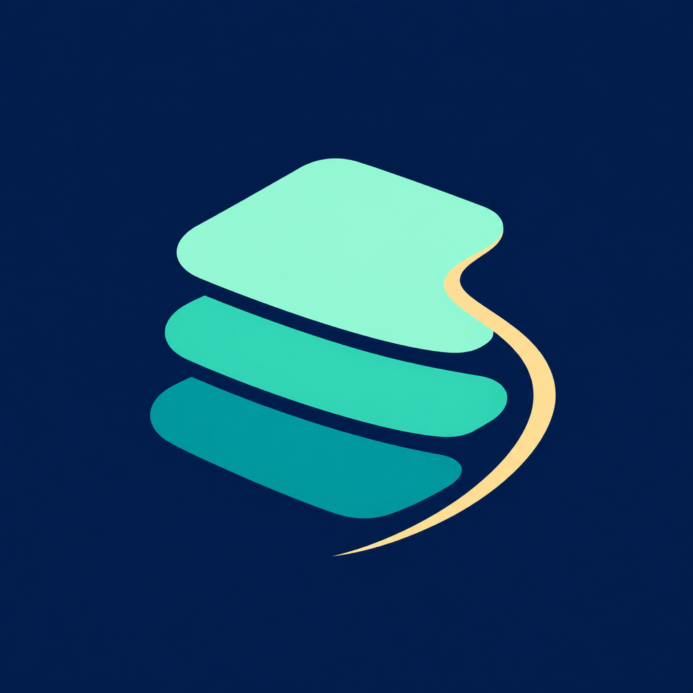

<div align="center">
  
  <h1>Sweepdeck</h1>
  <p><strong>Know what's using your storage. Review every cleanup before it reaches Trash.</strong></p>
  <p>
    <a href="https://github.com/miguel-osuna/Sweepdeck/actions/workflows/build.yml"></a>
    <a href="LICENSE"></a>
    
  </p>
</div>

Sweepdeck is a free, native macOS utility for inspecting local storage and reviewing
individual files before moving them to Trash. No accounts, subscriptions, telemetry,
network services, or background indexing.

## What it does

- Shows storage capacity, recommendations, and a partial explorer for authorized folders.
- Scans only folders you choose for old installers, Downloads items, logs, and large files.
- Lets you inspect each candidate, preview the exact paths, and choose what to move to Trash.
- Keeps a bounded local history and shows CPU, memory, swap, storage, and thermal readings.

## Safety by design

- Nothing scans at launch. You choose each folder before scanning it.
- The selection starts empty. Every category requires review.
- A five-minute preview is revalidated before each file moves to macOS Trash.
- Sweepdeck never permanently deletes files, empties Trash, or moves directories.
- Protected locations, hidden files, repositories, symlinks, packages, and cloud-managed files are excluded.

See [SAFETY.md](SAFETY.md) for the full eligibility rules and limitations.

## Scope

Sweepdeck handles individual regular files in explicitly authorized local folders.
File age and size help find items to review; they do not prove a file is disposable.
It does not remove directories or apps, find duplicates, mutate developer caches, scan
external or network volumes, or terminate processes. The folder explorer is partial
and uses the bounded scan results.

## Download and Homebrew

[Version 0.2.0 is available on GitHub Releases](https://github.com/miguel-osuna/Sweepdeck/releases/tag/v0.2.0).
Its app-only archive includes the Sweepdeck app icon. SHA-256:
`e31d64f80948461fe0f92d5c482c8f11c8f364ca81f8c326a40f8db8d2dbd760`.

The owner-managed Homebrew tap is maintained at
[`miguel-osuna/homebrew-tap`](https://github.com/miguel-osuna/homebrew-tap). The
Sweepdeck cask was published in [tap PR #2](https://github.com/miguel-osuna/homebrew-tap/pull/2).
Install with:

```sh
brew install --cask miguel-osuna/tap/sweepdeck
```

Homebrew's [tap trust behavior](https://docs.brew.sh/Tap-Trust) trusts only the
fully qualified cask above; it does not trust every formula and cask in the tap.

Installing by the short name requires these setup steps first:

```sh
brew tap miguel-osuna/tap
brew trust --cask miguel-osuna/tap/sweepdeck
brew install --cask sweepdeck
```

The cask installs only `Sweepdeck.app` and has no `zap` stanza or cleanup scripts.
Uninstall leaves Sweepdeck preferences and history in place.

### Gatekeeper on first launch

The free release is ad-hoc signed, without an Apple-issued Developer ID signature or
notarization ticket. In the disposable macOS 26 check, Gatekeeper blocked the first
open and said Apple could not verify Sweepdeck is free of malware. The dialog offered
**Move to Trash** or **Done**. Homebrew preserves quarantine, and the cask does not
bypass Gatekeeper or automate an approval.

The 0.2.0 release's [captured first-launch screen](https://github.com/miguel-osuna/Sweepdeck/actions/runs/39664467890)
shows the same warning. That check did not approve the app or verify a successful
post-approval launch.

If you decide to proceed, choose **Done**, then check **System Settings > Privacy &
Security** for **Open Anyway** after the attempted launch. Read Apple's [security
guidance](https://support.apple.com/en-au/102445) and continue only if you trust the
app and its source. The tap cask does not bypass Gatekeeper. See
[compatibility evidence](COMPATIBILITY.md) before installing.

## Build from source

Requires Apple Silicon, macOS 15+, Swift 6.2, the macOS SDK, and Rust 1.99.1. Xcode
or matching Command Line Tools are sufficient. Install Rust with `rustup`; the checked-in
`rust-toolchain.toml` selects the compiler plus `clippy` and `rustfmt`. The first Rust
use can download these components. Sweepdeck has no third-party Swift Package Manager
or Cargo crate dependencies; Rust builds the local accelerator.

```sh
bash scripts/swift.sh test
bash scripts/build-app.sh
open dist/Sweepdeck.app
```

The build creates a locally ad-hoc signed app. No developer identity, provisioning
profile, or App Store membership is required to build it. Public distribution may show
the Gatekeeper approval described above.

## First use

1. Choose a specific folder using **Choose Folder**. Nothing scans at startup.
2. Select **Scan Mac**. Sweepdeck scans only folders you authorized.
3. Open **Smart Cleanup**, expand a category, inspect the files, and select only what you no longer need.
4. Choose **Preview Cleanup** and review every path and rejected item.
5. Acknowledge the review and explicitly choose **Move Files to Trash**.

Finder's Trash can restore moved files. Moving files to Trash usually does not
immediately free disk space.

## Local data and privacy

Preferences and history live in
`~/Library/Application Support/Sweepdeck/state.json`. History can contain file paths
and retains at most 50 operations / 1,000 item results. Diagnostics export contains
counts and OS/app versions, not paths or file contents. No data is sent anywhere.

For isolated GUI validation, pass
`--sweepdeck-state-directory <temporary-directory>` to the app at launch. This
redirects only preferences and history; it does not add folders, scan, or authorize
cleanup.

## Documentation

- [Compatibility and verification](COMPATIBILITY.md)
- [Release process](Docs/RELEASING.md)
- [Architecture](ARCHITECTURE.md)
- [Safety and limitations](SAFETY.md)
- [Contributing](CONTRIBUTING.md)
- [Roadmap](Docs/ROADMAP.md)
- [License](LICENSE)
